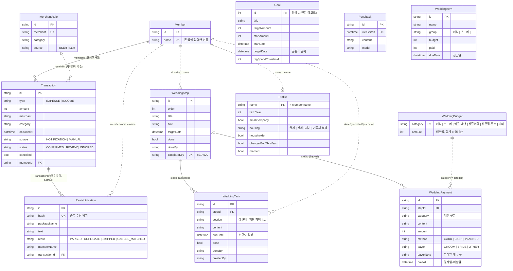

# 모아봄 DB 구조

Postgres + Prisma (`server/prisma/schema.prisma`). 실선은 외래키, 점선은 이름으로만 이어진 느슨한 연결이에요.

## 테이블 역할

| 묶음 | 테이블 | 하는 일 |
|---|---|---|
| 결제 수집 | `RawNotification` | 폰에서 온 알림 원문 전부. `hash`로 푸시·문자 이중 수신을 걸러요 |
| | `Transaction` | 파싱된 결제·입금 한 건. 직접 입력한 내역도 여기 들어가요 |
| | `Member` | 폰 앱에 입력한 이름. 둘이 쓰면 두 줄 |
| | `MerchantRule` | 가맹점 → 카테고리 학습 규칙. 직접 고치면 `USER`, Gemini가 분류하면 `LLM` |
| 목표·분석 | `Goal` | 목표 금액과 결혼식 날짜 (한 줄만) |
| | `Feedback` | 주마다 만드는 주간 피드백 |
| 결혼 준비 | `WeddingItem` | 예산표 항목 (예산 / 낸 돈 / 잔금일) |
| | `WeddingStep` | 이벤트 (시트의 20단계 + 직접 추가). 메모는 `note` |
| | `WeddingTask` | 이벤트 안의 체크리스트. `dueDate`가 있으면 캘린더에 소규모 일정으로 보여요 |
| | `WeddingPayment` | 이벤트별 결제관리 (예산 구분, 결제 방식, 결제자) |
| | `WeddingBudget` | 예산 구분별 배분액 (예산 탭 슬라이더) |
| 맞춤 | `Profile` | 팁을 거를 때 쓰는 내 정보 |

## 참고
- 카드 알림으로 들어온 결혼준비 결제(`Transaction`)와 이벤트에 직접 적는 결제(`WeddingPayment`)는 아직 따로예요. 예산 탭 사용량 막대는 `WeddingPayment`만 세요.
- 예산 구분 이름과 색은 `server/src/lib/wedding-meta.ts` 한 곳에서 정해요. 예산표 항목(`WeddingItem.group`)도 같은 이름을 써요.
- 체크한 사람(`doneBy`)과 `Profile`은 `Member.name`과 같은 이름 문자열로 이어져요. 외래키가 아니라서, 폰 앱에서 이름을 바꾸면 예전 기록은 예전 이름으로 남아요.
- 스키마를 바꾸면 Vercel 빌드에서 `prisma db push`가 자동으로 반영해요. 데이터가 지워지는 변경이면 빌드가 멈춰요.
